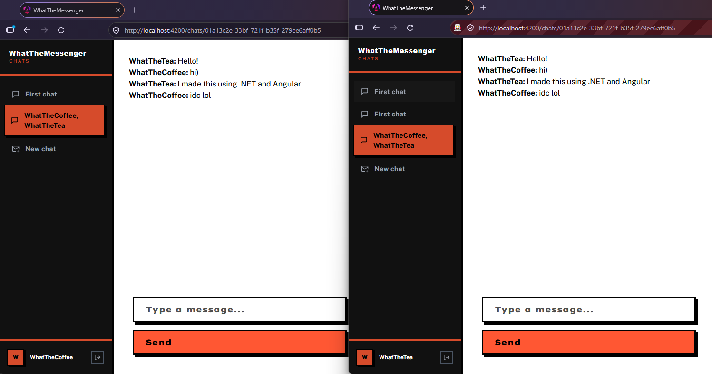

# ✉️ WhatTheMessenger - Real-time .NET + Angular messenger

This is a simple messaging app created in order to get experience on frontend tech, backend scalability and database nuances.

It is written in .NET and Angular and will be used as playground both for frontend and backend tech. To accelerate development while keeping interesting look-and-feel I chose [neobrutalism](https://neubrutalism.com/)



## Experiments

> 💡 Collection of insights from my experiments with this project

- [Spike of login requests](docs/experiments/login-spike.md)

## Development

### Prerequisites

- .NET SDK for API
- Node.js for client
- Bun for client
- `bun install` to restore frontend dependencies

### Full docker deployment

```sh
docker compose --profile deploy --env-file dev.env up
```

Backend is scalable here, so you could scale the `api` container:
```sh
docker compose --profile deploy --env-file dev.env up --scale api=2
```

### Hybrid docker deployment

If you wish to run the app locally with actual infrastructure, you can use the following commands:

1. Start the infrastructure
```sh
docker compose --profile infra --env-file dev.env up
```

2. Then start the backend (server) either via `full-stack (local)` configuration in VS Code or the following command:
```sh
cd server # ensure you are in the server folder
dotnet watch --project WhatTheMessenger.Api -lp "dev"
```

3. Client uses `bun` package manager, so you could run it via `bun run` command in terminal:
```sh
cd client # ensure you are in the client folder
bun run start
``` 

### Fullstack local deployment

This is default development profile for me, it is the same as `full-stack (local)` in VS Code, but you need to 
configure the launch profile in VS Code to use it: `> .NET: Select Launch Configuration -> dev (single-process)`

Or use the following commands:

```sh
cd server # ensure you are in the server folder
dotnet watch --project WhatTheMessenger.Api -lp "dev (single-process)"
```

And it is the same as in hybrid deployment for client:
```sh
cd client # ensure you are in the client folder
bun run start
``` 

#### Mock frontend UI

There's option to run UI without backend with `development` profile: 
```sh
cd client # ensure you are in the client folder

bun run ng serve --watch --configuration development
```
